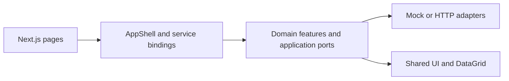

# ProofSpace Frontend

The web frontend for **ProofSpace**, an enterprise document-governance and review product prototype. It brings classification, review tasks, knowledge workflows, and source-linked review interactions into a typed Next.js application.

**Next.js 15 Pages Router · React 19 · TypeScript · CSS · Vitest**

企业文档治理前端。此公开快照默认使用 Mock adapter；真实鉴权、持久化与完整私有化部署不由这个仓库单独提供。

[Project case study](https://icn1vad.github.io/projects/proofspace/) · [Architecture](docs/FrontendArchitecture.md) · [Backend contract](docs/BackendApiContract.md) · [Portfolio overview](docs/PortfolioOverview.md)

## Start locally

Use a supported Node.js LTS release with npm.

```sh
npm ci
npm run dev
```

Open `http://localhost:3000`.

## Architecture



- `src/pages/` handles route entry points and server-side data assembly.
- `src/app/` composes the shell, module registry, typed routes, and services.
- `src/features/` separates domain, application, infrastructure, and presentation concerns.
- `src/shared/` contains reusable UI without feature-specific business logic.
- `src/infrastructure/http/` provides HTTP adapters and shared request behavior.

The module registry is a compile-time composition mechanism. It does not imply runtime plugin loading or automatically create Next.js routes.

## Verification

```sh
npm run typecheck
npm run lint
npm run test
npm run build
# Or run the repository's complete check script:
npm run check
```

These commands are defined in `package.json`. The portfolio documentation update does not change application behavior or claim a fresh end-to-end deployment test.

## Current boundaries

The default services use in-process mocks. This snapshot does not provide cross-instance persistence, production authentication, or transaction guarantees. Some HTTP and polling infrastructure is documented ahead of full business-page integration. Consult [the architecture document](docs/FrontendArchitecture.md) for the current limits, including preview and export support.
